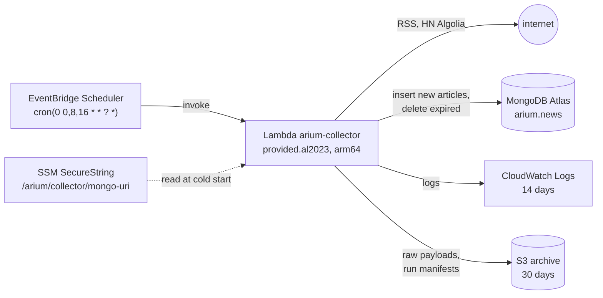

# Terraform: news collector on AWS Lambda (`devops/terraform/`)

Runs the news collector (`backend/cmd/collector`) as an AWS Lambda function on a schedule, writing articles
straight to MongoDB Atlas and archiving each run's raw payloads to S3. It's the cloud counterpart of the `collector`
service in Docker Compose, and the stack is cheap to create and destroy.

There are two Terraform stacks:

| Stack | Applied | Contents |
|---|---|---|
| [`bootstrap/`](bootstrap) | once, by hand, with admin credentials; local state | S3 bucket for Terraform state, S3 archive bucket, the GitHub Actions role's permissions and the permissions boundary |
| `.` (this directory) | from GitHub Actions ([`collector.yaml`](../../.github/workflows/collector.yaml)) or a laptop; state in S3 | Lambda, schedule, SSM parameter, IAM roles, log group |

The bootstrap holds what must survive a `terraform destroy` of the collector stack. The two stacks share names by
convention (`arium-collector-*`, `arium-tfstate-<account>`), not through remote state.



## How the Lambda differs from the Compose collector

Same binary, same sources and normalization. It switches to Lambda mode when `AWS_LAMBDA_RUNTIME_API` is set.

| | Compose collector | Lambda |
|---|---|---|
| Trigger | in-process scheduler (`-schedule`) | EventBridge Scheduler |
| Dedup state | `state/*.json` on the `collector_data` volume | MongoDB itself (`_id`, `title_key`) |
| Writes | files, then a full re-import into Mongo | insert-only into Mongo (`news.Service.Ingest`); stored articles keep their first `fetched_at` |
| Raw payloads, manifests | on the volume; a payload only when it changed | S3 archive bucket, same keys (`raw/<source>/<date>/<runID>.<ext>`, `runs/<runID>.json`); every payload, since there's no state to compare with. Best-effort: a failed write is logged and the run still succeeds |
| Retention | prunes files and Mongo | deletes from Mongo by `fetched_at` |
| Observability | JSON logs on stdout, Prometheus scrapes `/metrics` | JSON logs to CloudWatch; no `/metrics`, since nothing can scrape a function between invocations |

## Cost

At three runs a day, about 5 s each, the function, scheduler and logs stay within the AWS free tier. The SSM
standard parameter is free. The archive is a few MB and about 1,000 writes a month, which costs cents; it expires
objects after 30 days. The function runs outside a VPC (S3 is reached over its public endpoint), so there's no
NAT gateway, which would be the expensive part (about $32 a month). `terraform destroy` removes everything the
collector stack creates; the bootstrap's buckets stay.

## Prerequisites

- Terraform >= 1.10 (for S3 state locking without DynamoDB), and Go 1.26+ or Docker (`build.sh` falls back to the
  `golang:1.27` image; `go.mod` pins the go1.27.2 toolchain, which a local Go downloads automatically)
- The AWS CLI, logged in with admin credentials for the bootstrap (e.g. IAM Identity Center:
  `aws configure sso --use-device-code`, then `export AWS_PROFILE=<profile>`)
- An Atlas cluster. Because Lambda outside a VPC has no fixed egress IP, Atlas **Network Access** must allow
  `0.0.0.0/0` (the free tier can't use private endpoints). The database user needs `readWrite` on `arium` (it also
  creates the indexes).
- For CI: an IAM OIDC identity provider for `token.actions.githubusercontent.com` and a role (default name
  `github-arium`) whose trust policy allows `repo:fmolinar/arium:environment:aws`.

## 1. Bootstrap (once)

```sh
cd devops/terraform/bootstrap
terraform init
terraform apply          # -var github_actions_role_name=... if the role isn't github-arium
terraform output         # state_bucket, archive_bucket
```

Keep `bootstrap/terraform.tfstate`: it's gitignored, holds no secrets, and is needed to change these resources
later. The state bucket has `prevent_destroy`.

Then set these on GitHub (repo → Settings → Secrets and variables → Actions):

| Name | Kind | Value |
|---|---|---|
| `TF_STATE_BUCKET` | variable | `terraform output -raw state_bucket` |
| `AWS_REGION` | variable | the region, e.g. `us-west-2` |
| `AWS_ROLE_ARN` | variable | the OIDC role's ARN |
| `TF_VAR_MONGO_URI` | secret | the Atlas connection string |

## 2. Deploy from GitHub Actions

Actions → **Collector on AWS** → **Run workflow**, and choose:

- `plan`: show what would change.
- `apply`: create or update the stack, then invoke the function once and fail if that run fails.
- `destroy`: remove the stack. The archive and state buckets stay.

The job runs in the `aws` environment. Add required reviewers to it (Settings → Environments → aws) to approve
each run before it gets AWS credentials.

## Running Terraform from a laptop

It uses the same S3 state as CI, so either can apply or destroy what the other created.

```sh
cd devops/terraform
./build.sh                                   # builds build/bootstrap (linux/arm64)

# The URI from the repo-root .env (Atlas onboarding), without echoing it:
export TF_VAR_mongo_uri="$(grep '^MONGODB_URI=' ../../.env | cut -d= -f2- | tr -d '"')"

terraform init -backend-config="bucket=$(terraform -chdir=bootstrap output -raw state_bucket)" \
               -backend-config="region=us-west-2"
terraform apply

# Run once now instead of waiting for the next slot, and print the logs:
eval "$(terraform output -raw invoke_command)"

terraform destroy
```

Rerun `./build.sh` before `terraform apply` after changing backend code. `source_code_hash` makes Terraform
redeploy only when the binary changes. Set `schedule_enabled = false` to keep the function but only invoke it by
hand, or `archive_enabled = false` to stop archiving to S3.

A successful run logs a line like:

```json
{"level":"INFO","msg":"run stored","new":19,"duplicates_by_url":0,"duplicates_by_title":0,"expired":0,"sources":10}
```

`aws lambda invoke` prints `null` on success. Runs that fail (every source failed, or MongoDB unreachable)
return an error, which shows up in the function's `Errors` metric. Failed scheduled runs aren't retried. Runs
are idempotent, so the next one catches up.

## Showing the Atlas data in the frontend

The Lambda only writes. The frontend reads news through the API (`GET /api/v1/news`), so point the Compose
backend at the same cluster by setting `MONGO_URI` to the same connection string: in `devops/docker/.env` for a
manual `docker compose up`, or as the `MONGO_URI` GitHub secret for the deploy workflow. Unset, the backend keeps
using the local `mongo` service. The backend also stores users there, and it creates its indexes on startup, so
its database user needs `readWrite` on `arium` too, and Atlas Network Access must allow the Docker host's IP
(`0.0.0.0/0` already covers it).

The Compose `collector` keeps syncing to the local `mongo` either way. With the backend on Atlas, the Lambda is
the only thing writing news there.

## Testing locally without AWS

AWS's Runtime Interface Emulator runs the same handler against a local Mongo:

```sh
cd backend && CGO_ENABLED=0 GOOS=linux GOARCH=amd64 go build -tags lambda.norpc -o /tmp/rie/bootstrap ./cmd/collector
docker network create rie && docker run -d --rm --name rie-mongo --network rie mongo:latest
docker run --rm --network rie -p 9000:8080 -v /tmp/rie:/var/task:ro \
  -e MONGO_URI=mongodb://rie-mongo:27017 public.ecr.aws/lambda/provided:al2023 bootstrap
curl -XPOST localhost:9000/2015-03-31/functions/function/invocations -d '{}'
```

## Permissions

The CI role can only touch resources named `arium-collector*`, the `collector/` prefix of the state bucket, and
the SSM parameter (see [`bootstrap/ci.tf`](bootstrap/ci.tf)). It creates IAM roles, and a principal that can create
roles and pass them to Lambda could otherwise grant itself anything through them. So it may only create roles that
carry the `arium-collector-boundary` permissions boundary, and can't remove the boundary afterwards. The boundary
caps those roles at writing logs, reading the MongoDB URI parameter, writing to the archive, and invoking the
function.

## State and secrets

State is in `s3://arium-tfstate-<account>/collector/terraform.tfstate`, versioned, encrypted, TLS-only, and
locked with a `.tflock` object while a run holds it. It contains the MongoDB URI, because Terraform writes the SSM
parameter. The workflow gets it from the `TF_VAR_MONGO_URI` secret; the Lambda reads it from SSM, never from its
environment.
